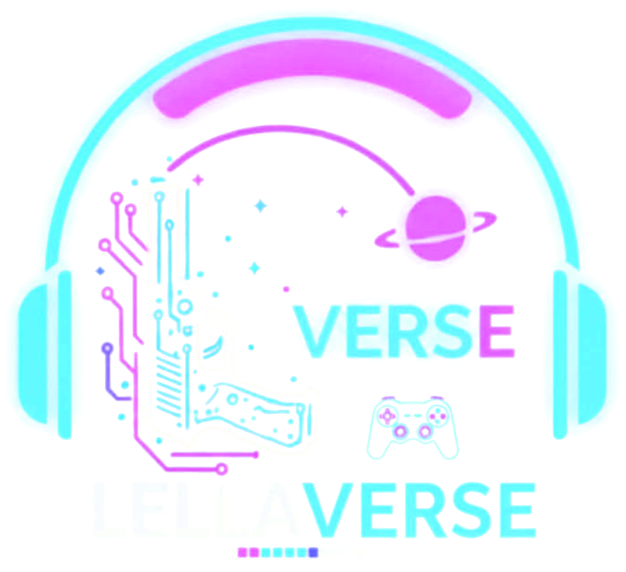

# LellaVERSE AI Shorts Builder 🎬⚡

  

  <b>AI-Powered Gaming Highlights & Sinhala-English Subtitle Generator</b> 
  <i>Transform long gaming livestreams and uploaded gameplay into viral, highly engaging 9:16 vertical Shorts with intelligent facecam layout and glowing word-synced subtitles.</i>

  
  
  
  

---

## 🌟 Overview

**LellaVERSE AI Shorts Builder** is an independently developed desktop application engineered specifically for gaming content creators and streamers. It automates the laborious process of reviewing hours of livestreams, detecting exciting climax moments, cropping facecam and gameplay into vertical 9:16 format, and generating synchronized bilingual (Sinhala + English) animated captions.

---

## 🚀 Key Features

### 1. 🧠 Full-Video Timeline Highlight Analysis
- **100% Source Timeline Coverage:** Regardless of whether you request 1, 3, or 10 highlights, the engine analyzes the **entire** source video from beginning to end before selecting clips.
- **Global Ranking & Deduplication:** Climax moments are ranked based on audio energy spikes, cheering, gameplay tension, and dialogue context. Duplicate and overlapping moments are automatically eliminated.
- **Strict 60-Second Duration Clamping:** Every exported Short is bounded to a maximum of 60 seconds (optimized for YouTube Shorts & TikTok).
- **Persistent Analysis Caching:** Full stream analysis is cached locally so you can generate additional unique shorts in seconds without reprocessing.

### 2. 🔍 Deep Learning Facecam Engine
- **OpenCV YuNet CNN Face Detector:** Uses lightweight deep learning (`models/face_detection_yunet_2023mar.onnx`) with temporal consistency tracking across 20 uniform timestamps.
- **Cutscene & Menu Rejection:** Eliminates false positives from in-game character portraits, UI menus, and transient animations.
- **Smart 9:16 Layouts:**
  - **Split Screen:** Upper 35% for detected Facecam; lower 65% for action-tracked gameplay.
  - **No-Cam Fallback:** Automatically switches to full 9:16 action crop or blur-fill when no streamer facecam is detected.

### 3. 🗣️ Precision Sinhala-English Bilingual Subtitles
- **Authentic Code-Switching Preservation:** Automatically distinguishes genuine English words (gaming terms, tech vocabulary, brand names) from Singlish phonetics, keeping English terms in Latin script (`"this game"`) without erroneous transliteration (`"දිස් ගේම්"`).
- **True ASR Millisecond Timing:** Subtitle cues align directly to speech acoustics with zero artificial syllable calculation.
- **Dynamic Styling & Glowing Karaoke:** High-contrast mobile-first presets with karaoke highlights, bouncy pop animations, and automatic video color-matching.

### 4. ⚡ Frame-Accurate Seeking & Zero-Drift PTS Sync
- **Keyframe Pre-Seeking:** Uses `cap.grab()` step-forward alignment to eliminate frozen or black opening frames.
- **Container PTS Audio Lock:** Injects `aresample=async=1:first_pts=0` across all FFmpeg rendering pipelines, guaranteeing zero audio-video drift across long stream renders.
- **Hardware Acceleration:** Auto-detects and prioritizes Intel Quick Sync (`h264_qsv`), NVIDIA NVENC, and AMD AMF with multi-threaded CPU fallback for low-end PCs.

---

## 💻 System Requirements

| Component | Minimum | Recommended |
| :--- | :--- | :--- |
| **Operating System** | Windows 10 (64-bit) | Windows 11 (64-bit) |
| **Processor (CPU)** | Intel Core i3 / AMD Ryzen 3 (4 Cores) | Intel Core i5/i7 (8th Gen+ with Intel QSV) or AMD Ryzen 5 |
| **Memory (RAM)** | 8 GB RAM | 16 GB RAM or higher |
| **Storage** | 3 GB free disk space | SSD with 10 GB free space |
| **Graphics (GPU)** | Integrated Graphics | Intel UHD/Iris Graphics or Dedicated NVIDIA/AMD GPU |
| **Network** | Internet connection for Gemini API | Broadband connection |

---

## 📦 Installation Options

### Option 1: Windows Universal Setup (Recommended)
Download and run `LellaVERSE_AI_Shorts_Builder_v1.0.0_Setup.exe`:
1. Follow the clean installation wizard.
2. Choose installation folder (Default: `C:\Program Files\LellaVERSE AI Shorts Builder`).
3. Select Desktop and Start Menu shortcut options.
4. Launch directly from your desktop icon!

### Option 2: Portable Edition
Download `LellaVERSE_AI_Shorts_Builder_v1.0.0_Portable.zip`:
1. Extract to any folder or external drive.
2. Double-click `Run_LellaVerse.bat` or `LellaVERSE.exe`.
3. No environment configuration or installation required!

For full installation details, see [INSTALLATION_GUIDE.md](INSTALLATION_GUIDE.md).

---

## 🔑 Google Gemini API Setup & Multi-Key Pool

The application uses Google Gemini Flash models for lightning-fast highlight analysis and verbatim speech transcription.

### Getting a Free Gemini API Key:
1. Visit [Google AI Studio](https://aistudio.google.com/app/apikey).
2. Sign in with any standard Google account.
3. Click **"Create API Key"** and copy your key.

### Multi-Key Rotation Pool:
In the application sidebar under **🔑 Gemini API Keys**, you can paste up to **4 API keys** (one per line):
- Work is automatically distributed across all keys in parallel.
- If one key exhausts its daily free-tier quota, the remaining keys automatically pick up the load without interrupting your work.

> [!NOTE]
> **Free Tier Quota Notice:** Google Gemini Free Tier is subject to daily request and rate limits. If you reach quota limits, create a new project in Google AI Studio, generate a fresh key, and paste it into the sidebar. Offline transcription is also available via the built-in **Whisper Offline** caption engine.

---

## 👨‍💻 Development Credits & Acknowledgements

- **Created By:** Lelum Anuradha Fernando
- **Brand:** LellaVERSE
- **Project Origin:** This application originated from an independent idea by Lelum Anuradha Fernando. Google Gemini was initially utilized for research, technical exploration, and architecture planning. Initial application development was carried out with assistance from Claude. Google Antigravity was subsequently used extensively for further development, system integration, debugging, performance optimizations, and final release preparation.
- **Inspiration:** A special acknowledgement to **Shehan Dilhara** for the inspiration received from a Sinhala subtitle generator demonstration video discovered on TikTok, which was expanded into this comprehensive gaming highlight and shorts creation suite.
- **AI Development Tools:**
  - Google Gemini – Research and AI integration
  - Claude – Initial development assistance
  - Google Antigravity – Subsequent development, testing, and refinement

*(Independent project. Not officially affiliated with or endorsed by Google, Anthropic, or ByteDance).*

---

## 🌐 Connect With LellaVERSE

- **GitHub:** [https://github.com/LelumFernando](https://github.com/LelumFernando)
- **YouTube:** [https://www.youtube.com/@LellaVerse](https://www.youtube.com/@LellaVerse)
- **Facebook Page:** [https://web.facebook.com/fb.lellaverse](https://web.facebook.com/fb.lellaverse)
- **Instagram:** [https://www.instagram.com/lelum.fernando/](https://www.instagram.com/lelum.fernando/)
- **TikTok:** [https://www.tiktok.com/@lelum.fernando](https://www.tiktok.com/@lelum.fernando)
- **Personal Facebook:** [https://web.facebook.com/Lelum.Fenando](https://web.facebook.com/Lelum.Fenando)

---

## 📄 License

Copyright (c) 2026 Lelum Anuradha Fernando (LellaVERSE). All Rights Reserved.  
See [LICENSE](LICENSE) for terms of use and [THIRD_PARTY_NOTICES.md](THIRD_PARTY_NOTICES.md) for third-party acknowledgements.
